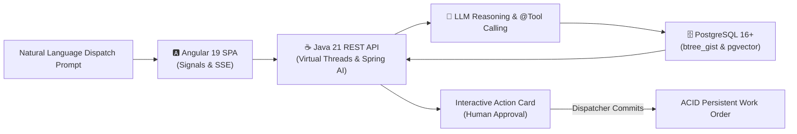

# Enterprise Solutions & Architecture Portfolio

Welcome to my portfolio of enterprise software solutions, reference architectures, and whitepapers. This repository showcases production-grade designs and implementations addressing complex business problems across enterprise domains—combining modern platform engineering, transactional data integrity, and pragmatic generative AI integration.

---

## 🗂️ Solutions Catalog

| Solution / Whitepaper | Business Domain | Core Technologies | Primary Business Problem Solved |
| :--- | :--- | :--- | :--- |
| [**Prompt-Driven Scheduling**](./prompt-driven-scheduling.md) | Industrial Maintenance, Heavy Fleet & Logistics | **Angular 19+**, **Java 21 / Spring Boot**, **Spring AI**, **PostgreSQL (`btree_gist`, `pgvector`)** | Eliminates multi-modal dispatcher friction by converting natural language emergency repair requests into deterministic schedules with zero hallucinations and physical double-booking prevention. |

---

## 🌟 Featured Solution: Prompt-Driven Scheduling

> 📄 **Full Architecture Document:** [**Prompt-Driven Scheduling: Enterprise Reference Architecture**](./prompt-driven-scheduling.md)

### Executive Overview
In heavy equipment maintenance and commercial logistics, asset breakdowns (e.g., an excavator blowing a hydraulic pump on a job site) require dispatchers to navigate complex, fragmented interfaces: checking technician certifications, equipment availability calendars, and parts catalogs while avoiding double-booking conflicts under tight SLA windows.

**Prompt-Driven Scheduling** solves this challenge through an intelligent natural language interface that reasons over operational constraints while strictly guaranteeing ACID consistency.

### Key Highlights
* **The 3 Golden Rules of Enterprise AI:** (1) The LLM never issues direct SQL writes; (2) Deterministic Java `@Tool` execution over hallucinations; (3) Mandatory Human-in-the-Loop approval for state mutations.
* **Reactive, Streaming UI:** Built with Angular 19+ Standalone Components, Angular Signals for local state management, and real-time Server-Sent Events (SSE) stream parsing for model reasoning.
* **High-Throughput Concurrency:** Powered by Java 21+ Project Loom Virtual Threads, decoupling high-latency LLM I/O from OS thread pool exhaustion.
* **Storage-Level ACID Integrity:** PostgreSQL `btree_gist` exclusion constraints enforce the physical impossibility of double-booking technicians or equipment at the database engine level.
* **Unstructured Technical Retrieval (RAG):** Uses `pgvector` with HNSW indexing to instantly retrieve equipment service manual chunks and replacement part serial numbers.

---

## 🏛️ Architectural Tenets Across This Portfolio

Every architecture in this repository is designed around proven enterprise engineering principles:

1. **Transactional Integrity First:** AI models coordinate and propose actions; authoritative relational databases and transactional services validate and persist them.
2. **Deterministic Contracts:** Strict data contracts using immutable data carriers (Java Records, TypeScript interfaces) and compile-time schema validation.
3. **Non-Blocking Scalability:** Modern concurrency primitives (Java Virtual Threads, reactive UI signals) engineered for real-world enterprise throughput.
4. **Defense in Depth & Safety Governance:** Role-Based Access Control (RBAC), prompt injection boundaries, and audited Human-in-the-Loop workflows.

---

## 👤 About the Author

**Jeff Kerns**  
Enterprise Systems Architect & Principal Software Engineer  
Specializing in distributed systems, modern Java/Spring backends, Angular frontends, and enterprise AI platform engineering.
