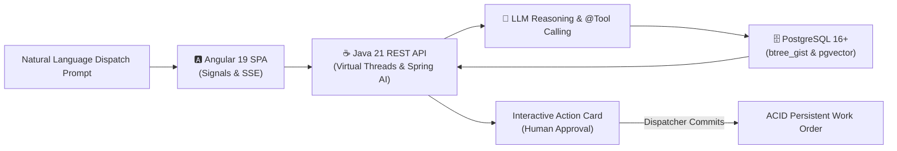
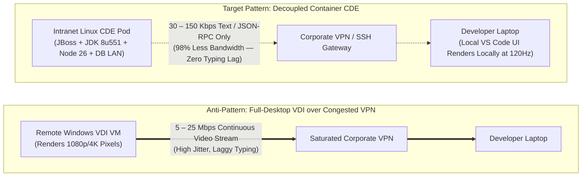

# Enterprise Solutions & Architecture Portfolio

Welcome to my portfolio of enterprise software solutions, reference architectures, and whitepapers. This repository showcases production-grade designs and implementations addressing complex business problems across enterprise domains—combining modern platform engineering, transactional data integrity, developer experience (DevEx), and pragmatic generative AI integration.

---

## 🗂️ Solutions Catalog

| Solution / Whitepaper | Business Domain | Core Technologies | Primary Business Problem Solved |
| :--- | :--- | :--- | :--- |
| [**Prompt-Driven Scheduling**](./prompt-driven-scheduling.md) | Industrial Maintenance, Heavy Fleet & Logistics | **Angular 19+**, **Java 21 / Spring Boot**, **Spring AI**, **PostgreSQL (`btree_gist`, `pgvector`)** | Eliminates multi-modal dispatcher friction by converting natural language emergency repair requests into deterministic schedules with zero hallucinations and physical double-booking prevention. |
| [**Legacy Java EE & JBoss CDE Migration**](./legacy-java-ee-jboss-cde-migration.md) | Enterprise DevEx, Remote Workstations, Infrastructure Modernization | **Red Hat JBoss EAP 7.x**, **Java 8 (JDK 8u551)**, **Angular (Node.js 26)**, **Maven**, **Oracle DB (:1521)**, **Coder / DevPod**, **DevContainer** | Solves corporate VPN saturation and sluggish VDI performance by replacing heavy pixel-streaming virtual desktops with decoupled containerized CDEs—cutting WAN bandwidth by 98% and slashing onboarding time from days to minutes. |

---

## 🌟 Featured Solutions

### 1. Prompt-Driven Scheduling: Enterprise Reference Architecture
> 📄 **Full Architecture Document:** [**Prompt-Driven Scheduling: Enterprise Reference Architecture**](./prompt-driven-scheduling.md)

#### Executive Overview
In heavy equipment maintenance and commercial logistics, asset breakdowns (e.g., an excavator blowing a hydraulic pump on a job site) require dispatchers to navigate complex, fragmented interfaces: checking technician certifications, equipment availability calendars, and parts catalogs while avoiding double-booking conflicts under tight SLA windows.

**Prompt-Driven Scheduling** solves this challenge through an intelligent natural language interface that reasons over operational constraints while strictly guaranteeing ACID consistency.

#### Key Architectural Highlights
* **The 3 Golden Rules of Enterprise AI:** (1) The LLM never issues direct SQL writes; (2) Deterministic Java `@Tool` execution over hallucinations; (3) Mandatory Human-in-the-Loop approval for state mutations.
* **Reactive, Streaming UI:** Built with Angular 19+ Standalone Components, Angular Signals for local state management, and real-time Server-Sent Events (SSE) stream parsing for model reasoning.
* **High-Throughput Concurrency:** Powered by Java 21+ Project Loom Virtual Threads, decoupling high-latency LLM I/O from OS thread pool exhaustion.
* **Storage-Level ACID Integrity:** PostgreSQL `btree_gist` exclusion constraints enforce the physical impossibility of double-booking technicians or equipment at the database engine level.
* **Unstructured Technical Retrieval (RAG):** Uses `pgvector` with HNSW indexing to instantly retrieve equipment service manual chunks and replacement part serial numbers.

---

### 2. Tabletop Case Study: Migrating Legacy Java EE, JBoss & Angular to a CDE
> 📄 **Full Architecture Document:** [**Migrating Legacy Java EE, JBoss & Angular Stack to a CDE**](./legacy-java-ee-jboss-cde-migration.md)

#### Executive Overview
When enterprises centralize developer environments to protect intellectual property and accommodate remote work, the default reflex is often full-desktop Virtual Desktop Infrastructure (VDI). However, when corporate VPNs suffer from congestion, streaming 60fps desktop video over VDI (5–25 Mbps per developer) exacerbates latency, typing lag, and disconnects.

This case study designs an enterprise migration of a complex legacy stack (**JDK 8u551, JBoss EAP 7.x, Angular / Node.js 26, snowflake `.m2` caches, and corporate intranet Oracle DB**) into a reproducible, self-hosted **Cloud Development Environment (CDE)**.

#### Key Architectural Highlights
* **98% Bandwidth Reduction:** Decouples the UI from the compute engine; only keystrokes and JSON-RPC telemetry travel over the VPN (30–150 Kbps vs. 5–25 Mbps for VDI), while multi-gigabyte Maven builds, `npm install`, and Oracle JDBC queries remain entirely on the high-speed data center LAN.
* **70%–100% TCO Savings vs. GitHub Codespaces:** Demonstrates why self-hosting via Coder OSS or DevPod on internal Linux VM infrastructure outperforms cloud-hosted Codespaces for intranet-bound databases, avoiding per-GB storage fees on large `.m2` and JBoss container layers.
* **Taming Legacy Dependencies:** Replaces fragile tribal knowledge (copying local `.m2` directories) with centralized artifact repository ingestion and pre-baked base container layers.
* **Zero Work-Loss Guarantee:** Persistence separation preserves developer uncommitted files, IDE state, and local caches across workspace restarts and base image updates.
* **Rigorous Red-Team Governance:** Answers hard objections from CISOs (DLP / browser-only mode), VDI admins (`cgroups v2` noisy neighbor limits), legacy Eclipse developers (KasmVNC app streaming / JetBrains Gateway), and DBAs (Oracle Edition-Based Redefinition).

---

## 🏛️ Architectural Tenets Across This Portfolio

Every architecture in this repository is designed around proven enterprise engineering principles:

1. **Transactional Integrity First:** AI models coordinate and propose actions; authoritative relational databases and transactional services validate and persist them.
2. **Deterministic Contracts:** Strict data contracts using immutable data carriers (Java Records, TypeScript interfaces) and compile-time schema validation.
3. **Non-Blocking Scalability:** Modern concurrency primitives (Java Virtual Threads, reactive UI signals) engineered for real-world enterprise throughput.
4. **Bandwidth & Compute Efficiency:** Lightweight remote protocols and containerization that optimize network consumption and server density.
5. **Defense in Depth & Safety Governance:** Role-Based Access Control (RBAC), prompt injection boundaries, and audited Human-in-the-Loop workflows.

---

## 👤 About the Author

**Jeff Kerns**  
Enterprise Systems Architect & Principal Software Engineer  
Specializing in distributed systems, modern Java/Spring backends, Angular frontends, developer platforms, and enterprise AI platform engineering.
