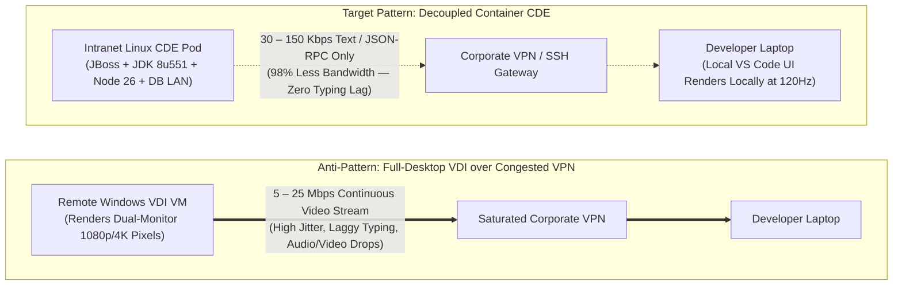
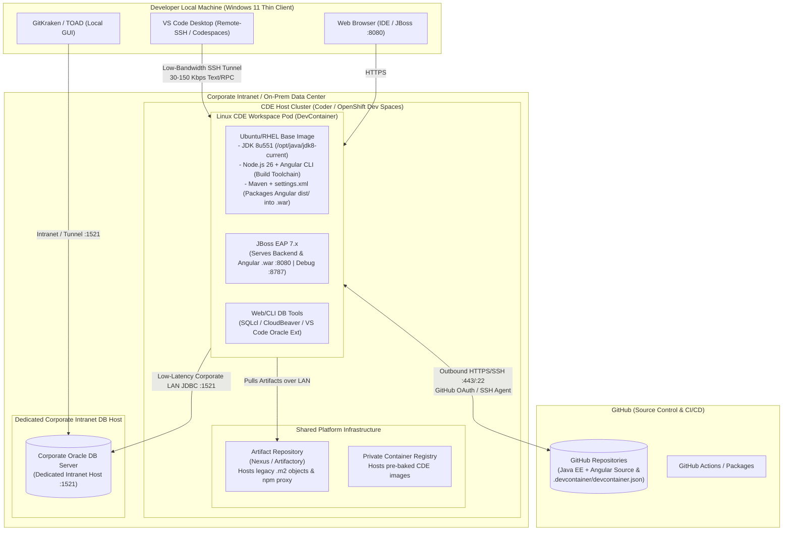
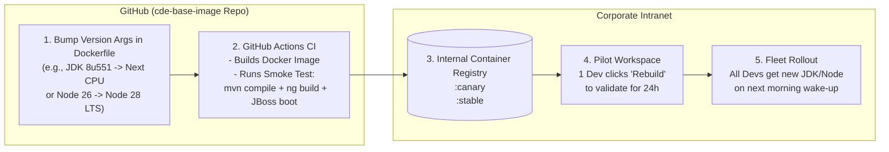

<a id="top"></a>

# 🧪 Enterprise Case Study: Migrating a Legacy Java EE, JBoss & Angular Stack to Cloud Development Environments (CDEs)
### Eliminating Corporate VPN Saturation, VDI Latency, and Environment Drift via Self-Hosted Container Workspaces

---

> **Domain:** Enterprise Developer Experience (DevEx), Infrastructure Modernization, Remote Workstation Architecture  
> **Target Audience:** CIOs, CTOs, CISOs, Principal Architects, Lead DevOps & Platform Engineers  
> **Core Tech Stack:** Red Hat JBoss EAP 7.x, Java 8 (JDK 8u551), Angular (Node.js 26 build toolchain), Maven, Oracle DB (:1521), Coder / DevPod / OpenShift Dev Spaces, DevContainer (`.devcontainer.json`)  
> **Key Architecture Patterns:** Containerized CDEs, Decoupled Thin-Client (JSON-RPC over SSH), Persistent Home Volumes, Image-as-Code Lifecycle, Bandwidth Optimization (98% reduction vs VDI)

---

> [!IMPORTANT] Architectural Disclaimer (Composite Enterprise Archetype)
> This document is an independent architectural tabletop study based on a **composite enterprise archetype** common across financial, healthcare, and public-sector organizations (Java 8, Red Hat JBoss EAP 7.x, Angular/Node.js, Maven `.m2` caches, and intranet Oracle databases). Version numbers, configurations, and package names are illustrative and do not represent the proprietary infrastructure of any specific organization.

---

## 🧭 Navigation & Table of Contents

| Section | Description |
| :--- | :--- |
| [**1. Executive Summary & The VPN / VDI Bottleneck**](#1-executive-summary--the-vpn--vdi-bottleneck) | Core problem statement and why full-desktop VDI fails over corporate VPNs |
| [**2. Current State Inventory & Friction Points**](#2-current-state-inventory--friction-points) | Technical audit of OS, JDK 8, JBoss EAP 7, Node 26, Maven `.m2`, TOAD, and GitHub |
| [**3. Target CDE Architecture Options**](#3-target-cde-architecture-options) | Container CDE (Self-Hosted Intranet vs Codespaces) vs Cloud VDI comparison |
| [**4. Component-by-Component Migration Strategy**](#4-component-by-component-migration-strategy) | Step-by-step migration for `.m2`, JBoss, Node 26, IDEs, Oracle DB tooling, and Git |
| [**5. Reference CDE Blueprint (`Dockerfile` + `devcontainer.json`)**](#5-reference-cde-blueprint-dockerfile--devcontainerjson) | Production-ready `Dockerfile` and `devcontainer.json` configuration |
| [**6. Phased Rollout Plan**](#6-phased-rollout-plan) | 4-phase rollout methodology and milestone validation gates |
| [**7. Audience-Specific Perspectives & Value Propositions**](#7-audience-specific-perspectives--value-propositions) | Tailored ROI for C-Level executives, application developers, and DBAs |
| [**8. Self-Hosted CDE vs. GitHub Codespaces: Cost & Architecture**](#8-self-hosted-cde-vs-github-codespaces-architecture--cost-comparison) | TCO comparison (saving 70%–100%) and intranet connectivity benefits |
| [**9. "Day in the Life" Developer Walkthrough**](#9-day-in-the-life-developer-walkthrough-end-to-end-feature-flow) | End-to-end morning-to-evening flow across Oracle, Java 8 REST, and Angular |
| [**10. Container Image Maintenance & Lifecycle**](#10-container-image-maintenance--lifecycle-quarterly-jdk-updates--nodejs-upgrades) | Automated quarterly JDK updates, Node.js version switching, and canary rollouts |
| [**11. Criticisms, Edge Cases & Counter-Measures (Red-Team Q&A)**](#11-criticisms-edge-cases--architectural-counter-measures-red-team-qa) | Concrete architectural answers to InfoSec, VDI admins, Eclipse devs, and DBAs |
| [**12. Key Tabletop Questions for Stakeholders**](#12-key-tabletop-questions-for-stakeholders) | Critical decision checklist for leadership and engineering teams |

---

<a id="1-executive-summary--the-vpn--vdi-bottleneck"></a>
## 1. Executive Summary & The VPN / VDI Bottleneck

[⬆ Return to Top](#top) • [Next: Current State Inventory ➡](#2-current-state-inventory--friction-points)

This tabletop case study evaluates how to transition a classic enterprise Windows 11 developer configuration—featuring a Java 8 backend (JDK `8u551`, Red Hat JBoss EAP `7.x`, legacy `.m2` artifacts) and an Angular frontend built via Node.js 26 and packaged into a `.war` for JBoss deployment—into a reproducible, low-bandwidth **Cloud Development Environment (CDE)** (such as Coder, DevPod, Gitpod, or Red Hat OpenShift Dev Spaces).

### 1.1 Why Full-Desktop VDI Fails Over Congested Corporate VPNs (VDI vs. CDE Bandwidth)

When enterprises attempt to centralize developer environments, the default reflex is often **Virtual Desktop Infrastructure (VDI)**—streaming a full Windows 11 desktop over RDP, Citrix HDX, or PCoIP. However, **when a corporate VPN is already suffering from bandwidth saturation and packet loss, rolling out VDI makes the problem catastrophically worse**:



| Metric | Traditional Windows VDI (RDP / PCoIP / Citrix) | Container-Based CDE (VS Code Remote-SSH / DevContainer) | Architectural Impact on Saturated VPN |
| :--- | :--- | :--- | :--- |
| **What Travels Over the Wire** | **Compressed Video Pixels** (60fps screen repaints every time a developer scrolls code or a terminal outputs logs) | **Keystrokes & JSON-RPC Text Only** (LSP autocomplete events, debugger coordinates, terminal text) | **CDE reduces per-developer WAN/VPN traffic by ~95%–98%.** |
| **Per-Developer Bandwidth** | **5 Mbps – 25+ Mbps** continuous per active developer | **30 Kbps – 150 Kbps** average during coding | **1 VDI user consumes as much VPN bandwidth as ~100 CDE users.** |
| **Typing & Scrolling Latency** | **High Sensitivity:** Any VPN jitter (`>50ms`) causes noticeable cursor lag, blurry text compression artifacts, and rubber-banding. | **Zero Local Input Lag:** The IDE UI runs natively on the laptop's local GPU; typing and scrolling are instant even on high-latency links. | Developers get a native desktop feel even over constrained links. |
| **Heavy Data Traffic (`mvn`, `npm`, Oracle `:1521`)** | Often still hairpins through corporate proxy/VPN if local laptops are used, or taxes VDI storage IOPS. | **100% Contained on Intranet LAN:** Multi-gigabyte `.m2` downloads, `npm install`, and Oracle DB queries never cross the VPN. | Eliminates developer build traffic from the VPN concentrator entirely. |

---

<a id="2-current-state-inventory--friction-points"></a>
## 2. Current State Inventory & Friction Points

[⬆ Return to Top](#top) • [Previous: Executive Summary ⬅](#1-executive-summary--the-vpn--vdi-bottleneck) • [Next: Architecture Options ➡](#3-target-cde-architecture-options)

| Component | Current Configuration | CDE Migration Challenge / Friction Point |
| :--- | :--- | :--- |
| **OS** | Windows 11 | Path separators (`\` vs `/`), case-insensitivity bugs, slow Windows NTFS I/O during `npm install` / Angular builds, Windows-only GUI tools (TOAD). |
| **Java Runtime** | JDK `8u551` (Current Java 8 CPU) | Actively patched Java 8 runtime, but still requires Java 8 runtime targeting while modern IDE language servers (VS Code / Eclipse JDT LS) require JDK 17/21+ to run. Oracle OTN licensing/subscription considerations if using Oracle JDK vs. Red Hat/Temurin OpenJDK 8. |
| **App Server** | Red Hat JBoss EAP `7.x` | Hosts both the Java EE backend and the Angular frontend `.war` artifact. Stateful XML configurations (`standalone.xml`), JBoss module definitions, and proprietary Red Hat patches. |
| **Frontend Build Toolchain** | Node.js `26` + Angular CLI (Dev-only) | Node.js is strictly a developer-machine build tool (not a production runtime). Rebuilding and repackaging the Angular `.war` on every UI tweak is slow unless inner-loop dev server proxying (`ng serve` -> JBoss) is configured. |
| **IDEs** | Eclipse Java EE (Red Hat JBoss Tools) & VS Code | Eclipse relies heavily on local GUI and tight local JBoss server adapters. VS Code is natively CDE-ready. |
| **Build & Artifacts** | Maven (`mvn`) + pre-populated `.m2` repo | **High Risk:** Curated `.m2` cache passed around via archive/network share containing legacy or internal JARs not hosted on public Maven Central. |
| **Database Tooling** | Oracle SQL Developer & Quest TOAD | Thick-client GUI apps; TOAD is strictly Windows-native and heavily used by DBAs for advanced Oracle administration/PL-SQL. |
| **Source Control** | GitHub (`git` CLI / GitKraken) | Repos hosted on GitHub while the Oracle DB lives on the corporate intranet. Requires hybrid connectivity (outbound HTTPS/SSH to GitHub + internal LAN access to Oracle DB) and GitHub OAuth/SSH integration for GitKraken & IDEs. |

---

<a id="3-target-cde-architecture-options"></a>
## 3. Target CDE Architecture Options

[⬆ Return to Top](#top) • [Previous: Current State Inventory ⬅](#2-current-state-inventory--friction-points) • [Next: Migration Strategy ➡](#4-component-by-component-migration-strategy)

Because **Git repositories are on GitHub** while the **Oracle Database is on the corporate intranet**, there are two primary architectural patterns for hosting CDE compute:
1. **Option A1 (Self-Hosted CDE in Corporate Intranet — e.g., Coder / OpenShift Dev Spaces / DevPod):** CDE pods run inside the corporate network with direct LAN access (`:1521`) to the Oracle DB and outbound HTTPS/SSH (`:443`/`:22`) to GitHub.
2. **Option A2 (GitHub Codespaces + Hybrid Intranet Bridge):** CDE runs natively in GitHub's cloud directly attached to repos, using an encrypted **GitHub Actions runner / WireGuard / Tailscale subnet router** or Azure VNet integration to reach the corporate intranet Oracle DB and internal Nexus/Artifactory.



### Option A: Linux Container-Based CDE (Recommended)
* **Platform Choices:**
  * **Self-Hosted on Corporate Intranet (Coder / OpenShift Dev Spaces):** Best when keeping CDE compute next to the corporate intranet Oracle DB (`:1521`) and internal `.m2` Nexus repository is top priority. Integrates directly with GitHub via a GitHub App/OAuth so developers click "Open in CDE" directly from a GitHub repo or PR.
  * **GitHub Codespaces (Cloud-Hosted with VNet/VPN Bridge):** Native integration with GitHub repos and zero CDE cluster infrastructure to manage, provided a secure network bridge (Azure ExpressRoute/VPN or Tailscale/WireGuard tunnel) is established back to the corporate intranet for Oracle DB (`:1521`) and internal `.m2` artifact access.
* **How it works:** The compute environment is defined right inside the GitHub repository via `.devcontainer/devcontainer.json`. Developers stay on their Windows 11 laptops using VS Code or browser-based IDEs, while all builds, Node 26 compilation, and JBoss EAP 7.x execution happen inside the remote Linux container.

### Option B: Cloud VDI / Windows VM Workspace (Fallback)
* **Platform:** AWS WorkSpaces, Azure Dev Box, or On-Prem VMware Horizon / Citrix VDI.
* **How it works:** Lifts and shifts the exact Windows 11 environment into a virtual desktop VM.
* **Trade-offs:** 100% compatibility with TOAD, desktop Eclipse, and GitKraken out-of-the-box, **but consumes 5–25 Mbps of continuous video-stream bandwidth per user over the VPN**, suffers from slow boot times, requires high RAM/CPU overhead per VM, and lacks container immutability.

---

<a id="4-component-by-component-migration-strategy"></a>
## 4. Component-by-Component Migration Strategy

[⬆ Return to Top](#top) • [Previous: Architecture Options ⬅](#3-target-cde-architecture-options) • [Next: Reference Blueprint ➡](#5-reference-cde-blueprint-dockerfile--devcontainerjson)

### 4.1 Taming the `.m2` Repository ("The Snowflake Cache")
Passing around an archive of a local `.m2` repository is the single biggest blocker to ephemeral CDEs. If a workspace is destroyed and recreated, downloading or extracting a multi-gigabyte `.m2` zip on every boot degrades startup time.
1. **Audit & Ingest (Best Practice):** Stand up an internal **Sonatype Nexus** or **JFrog Artifactory** instance. Run a bulk-import script on the golden `.m2` directory to publish all internal/legacy JARs into a hosted `legacy-thirdparty` repository, while proxying Maven Central for standard dependencies.
2. **Pre-Baked Base Layer (Fast Cache):** In the CDE base `Dockerfile`, pre-populate `/home/developer/.m2/repository` with the most common legacy dependencies, or mount a read-only shared Persistent Volume Claim (PVC) as a Maven `<localRepository>` fallback.

### 4.2 Containerizing JDK `8u551` + JBoss EAP `7.x` + Node.js `26`
Create a golden multi-stage **Enterprise CDE Base Image**:
* **Base OS:** Red Hat UBI 8/9 or Ubuntu 22.04 LTS.
* **JDK `8u551`:** Install the current `jdk-8u551-linux-x64.tar.gz` (or equivalent Red Hat OpenJDK 8 / Eclipse Temurin 8 package if standardizing on open-source) into `/opt/java/jdk1.8.0_551`, symlink it to `/opt/java/jdk8-current`, and import corporate Root CAs into `jre/lib/security/cacerts` at build time.
  * *Note on IDE Java requirements:* Modern VS Code Java extensions (`redhat.java`) and latest Eclipse builds require **JDK 17 or 21** just to run the IDE/Language Server itself, even when compiling and running applications against **JDK 8u551**. Install JDK 21 alongside JDK 8u551: use JDK 21 for the IDE language server, and configure Maven toolchains / runtime `JAVA_HOME` to point to `8u551`.
* **JBoss EAP `7.x`:** Extract the JBoss EAP 7.x distribution to `/opt/jboss/eap-7`. Configure `standalone.conf` to enable remote debugging (`--debug *:8787`) and bind management/HTTP interfaces to `0.0.0.0` so the CDE proxy can forward ports (`8080`, `9990`) to the developer's browser.
* **Node.js `26` (Angular Build & Packaging Toolchain):** Since Node.js is strictly a developer-machine build dependency used to compile the Angular SPA before wrapping it into a `.war` for JBoss:
  * **Full `.war` Build Workflow:** Install Node.js 26 globally in the CDE image (and align with `frontend-maven-plugin` if Maven drives the Angular build, pointing `<installDirectory>` to the pre-installed Node 26 binary so Maven doesn't re-download Node on every build). Linux filesystem performance in a CDE will dramatically speed up `npm ci` and `ng build` compared to Windows 11 NTFS + Defender scanning.
  * **Fast Inner-Loop Option (`ng serve` Proxy vs. Full `.war` Redeploy):** In addition to building and deploying the full `.war` to JBoss (`:8080`), developers can optionally run `ng serve --port 4200 --proxy-config proxy.conf.json` inside the CDE (proxying `/api` calls to local JBoss `:8080`) for instant Angular Hot Module Replacement (HMR), only running the full `.war` Maven packaging step before integration testing or commit.

### 4.3 Transforming the IDE Experience (Eclipse & VS Code)
* **VS Code Users:** Seamless transition. Using the **VS Code Remote - SSH** extension (with the **Extension Pack for Java** and **Red Hat Server Connector**), developers get a native local UI while the language server, Maven, Node 26, and JBoss run inside the CDE.
* **Eclipse Java EE Users:** Three transition paths:
  1. **Red Hat OpenShift Dev Spaces / Eclipse Che:** Provides browser-based IDEs tailored for Red Hat stacks.
  2. **Desktop Eclipse inside the CDE via KasmVNC / XPRA:** Coder and similar CDEs allow running full Linux desktop Eclipse inside the container and streaming only the application window when needed.
  3. **Gradual Migration to VS Code / IntelliJ Gateway:** Provide pre-configured `.vscode/launch.json` and `tasks.json` that replicate the "Run on JBoss Server" single-click workflow from Eclipse.

### 4.4 Database Tooling (Oracle SQL Developer & TOAD)
* **Developers (SQL Developer):**
  * Replace heavy local installs with **Oracle SQL Developer Extension for VS Code** (official extension from Oracle that runs directly inside the remote CDE workspace). Large query result sets are fetched over the data center LAN and paginated as lightweight text to the editor rather than hauling heavy JDBC traffic across the VPN.
  * Alternatively, bundle **Oracle SQLcl** (CLI) or run **DBeaver / CloudBeaver** as a web app inside the CDE pod.
* **DBAs (TOAD):**
  * Because TOAD is deeply ingrained in DBA workflows and is Windows-only, **do not force DBAs off TOAD**. Instead, provide DBAs with either:
    1. A lightweight CDE CLI port-forward (`coder port-forward` / `kubectl port-forward`) so their local Windows 11 TOAD connects securely through the CDE tunnel (`:1521`) to the database.
    2. A dedicated DBA Jump Host / Bastion VM for heavy administrative operations.

### 4.5 GitHub, `git` CLI & GitKraken
* **GitHub Native Integration:** Storing `.devcontainer/devcontainer.json` directly in GitHub repositories allows one-click workspace launches per branch or Pull Request.
* **Authentication (`gh` CLI / OAuth / SSH Forwarding):**
  * Configure the CDE platform (Coder or GitHub Codespaces) as a **GitHub OAuth App** so workspaces automatically authenticate `git` pushes/pulls and the GitHub CLI (`gh`) without developers manually copying SSH private keys into containers.
  * In VS Code, the **GitHub Pull Requests** extension (`GitHub.vscode-pull-request-github`) lets developers review PRs and trigger builds directly inside the CDE.
* **GitKraken:** GitKraken has first-class **GitHub integration** and **GitKraken Workspaces**. Developers who prefer GitKraken's visual commit graph can either:
  1. Run the Linux build of GitKraken inside the CDE connected to their GitHub account.
  2. Connect local Windows 11 GitKraken to the remote CDE workspace directory over SSH/SFTP, or use GitKraken's GitHub integration for PRs/branches while building inside the CDE.

---

<a id="5-reference-cde-blueprint-dockerfile--devcontainerjson"></a>
## 5. Reference CDE Blueprint (`Dockerfile` + `devcontainer.json`)

[⬆ Return to Top](#top) • [Previous: Migration Strategy ⬅](#4-component-by-component-migration-strategy) • [Next: Phased Rollout Plan ➡](#6-phased-rollout-plan)

### Reference `Dockerfile`
```dockerfile
FROM registry.access.redhat.com/ubi8/ubi:latest

ARG JAVA_8_VERSION=8u551
ARG JAVA_8_FOLDER=jdk1.8.0_551
ARG NODE_VERSION=26.0.0

# 1. Install core utilities, git, and Node.js 26 dependencies
RUN dnf install -y git unzip tar wget curl procps-ng which shadow-utils && \
    dnf clean all

# 2. Install Current Java 8 JDK 8u551 (for compilation & JBoss runtime) 
#    AND JDK 21 (required by modern IDE Language Servers)
COPY artifacts/jdk-${JAVA_8_VERSION}-linux-x64.tar.gz /tmp/
RUN mkdir -p /opt/java && \
    tar -xzf /tmp/jdk-${JAVA_8_VERSION}-linux-x64.tar.gz -C /opt/java && \
    ln -sfn /opt/java/${JAVA_8_FOLDER} /opt/java/jdk8-current && \
    rm /tmp/jdk-${JAVA_8_VERSION}-linux-x64.tar.gz && \
    dnf install -y java-21-openjdk-devel maven

ENV JAVA_HOME=/opt/java/jdk8-current
ENV PATH="${JAVA_HOME}/bin:${PATH}"

# 3. Install JBoss EAP 7.x
COPY artifacts/jboss-eap-7.x.zip /tmp/
RUN mkdir -p /opt/jboss && \
    unzip -q /tmp/jboss-eap-7.x.zip -d /opt/jboss && \
    ln -sfn /opt/jboss/jboss-eap-7.* /opt/jboss/eap-current && \
    rm /tmp/jboss-eap-7.x.zip
ENV JBOSS_HOME=/opt/jboss/eap-current

# 4. Install Node.js 26 via binary tarball
COPY artifacts/node-v${NODE_VERSION}-linux-x64.tar.xz /tmp/
RUN tar -xJf /tmp/node-v${NODE_VERSION}-linux-x64.tar.xz -C /usr/local --strip-components=1 && \
    rm /tmp/node-v${NODE_VERSION}-linux-x64.tar.xz

# 5. Create non-root developer user & pre-seed Maven config + legacy .m2 cache
RUN useradd -m -s /bin/bash developer && \
    chown -R developer:developer /opt/jboss/
USER developer
COPY --chown=developer:developer artifacts/settings.xml /home/developer/.m2/settings.xml
# Optional: Seed legacy offline jars if Nexus migration is still in progress
COPY --chown=developer:developer artifacts/legacy-m2-seed/ /home/developer/.m2/repository/
```

### Reference `devcontainer.json`
```json
{
  "name": "Enterprise JBoss EAP 7.x + JDK 8u551 + Node 26 CDE",
  "build": {
    "dockerfile": "Dockerfile"
  },
  "forwardPorts": [8080, 9990, 8787, 4200],
  "portsAttributes": {
    "8080": { "label": "JBoss HTTP (Backend + Angular .war)" },
    "9990": { "label": "JBoss Admin Console" },
    "8787": { "label": "JBoss JDWP Debugger" },
    "4200": { "label": "Angular Live Dev Server (Optional HMR Proxy)" }
  },
  "customizations": {
    "vscode": {
      "extensions": [
        "redhat.java",
        "vscjava.vscode-java-debug",
        "vscjava.vscode-maven",
        "redhat.vscode-rsp-ui",
        "Angular.ng-template",
        "Oracle.sql-developer",
        "GitHub.vscode-pull-request-github",
        "eamodio.gitlens"
      ],
      "settings": {
        "java.jdt.ls.java.home": "/usr/lib/jvm/java-21-openjdk",
        "java.configuration.runtimes": [
          {
            "name": "JavaSE-1.8",
            "path": "/opt/java/jdk8-current",
            "default": true
          }
        ],
        "maven.executable.options": "-s /home/developer/.m2/settings.xml"
      }
    }
  }
}
```

---

<a id="6-phased-rollout-plan"></a>
## 6. Phased Rollout Plan

[⬆ Return to Top](#top) • [Previous: Reference Blueprint ⬅](#5-reference-cde-blueprint-dockerfile--devcontainerjson) • [Next: Stakeholder Perspectives ➡](#7-audience-specific-perspectives--value-propositions)

1. **Phase 1: Artifact & Dependency Hygiene (Weeks 1–2)**
   * Extract the `.m2` archive repository and upload all un-hosted/legacy JARs into a centralized Nexus/Artifactory repository.
   * Store `jdk-8u551` and `jboss-eap-7.x` installation media in versioned object storage (automating future quarterly Java 8 CPU updates directly in the base image CI pipeline).
   * Audit Windows-specific file paths in `pom.xml`, Ant scripts, or JBoss `standalone.xml` (e.g., `C:\temp\logs` -> `${jboss.server.log.dir}`).
2. **Phase 2: Golden Container Image & Pilot (Weeks 3–4)**
   * Build the Linux CDE image containing JDK 8u551, JDK 21 (for IDE LSP), JBoss EAP 7.x, and Node 26.
   * Pilot with 2–3 VS Code developers over the corporate VPN to benchmark bandwidth savings vs. VDI and validate hot-deployment to JBoss and Oracle DB connectivity.
3. **Phase 3: Eclipse & DBA Workflow Bridging (Weeks 5–6)**
   * Configure browser-streamed Eclipse (via KasmVNC) or Red Hat Dev Spaces for developers who require specific legacy Eclipse plugins that lack VS Code equivalents.
   * Establish secure SSH port-forwarding recipes for DBAs who continue using local TOAD on Windows 11.
4. **Phase 4: Full Onboarding & Deprecation of Local Setup**
   * New hires spin up a ready-to-code environment in `< 2 minutes` instead of spending days configuring JDK 8u551, JBoss XMLs, and copying `.m2` folders.

---

<a id="7-audience-specific-perspectives--value-propositions"></a>
## 7. Audience-Specific Perspectives & Value Propositions

[⬆ Return to Top](#top) • [Previous: Phased Rollout Plan ⬅](#6-phased-rollout-plan) • [Next: Cost Comparison ➡](#8-self-hosted-cde-vs-github-codespaces-architecture--cost-comparison)

### 7.1 Executive / C-Level (CIO, CTO, CISO, VP of Engineering)
* **Solving the VPN & VDI Bandwidth Crisis (CIO / VP of Infra):** Rolling out full-desktop VDIs over a congested corporate VPN forces `5–25 Mbps` of real-time video streams per developer through an already saturated pipe. A container CDE sends only keystrokes and IDE telemetry (`30–150 Kbps`—a **98% bandwidth reduction**), keeping all heavy Maven, npm, and Oracle DB traffic inside the data center LAN.
* **Strategic Risk Reduction ("Eliminating the Bus Factor"):** Today, the build relies on a manually curated `.m2` directory of legacy objects and complex local JBoss EAP 7.x configurations on Windows 11 laptops. Moving this into a version-controlled CDE base image and centralized artifact repository turns tribal knowledge into institutional code.
* **Security & Zero-Trust Compliance (CISO):**
  * **No Source Code or DB Credentials on Laptops:** Intellectual property, `.m2` proprietary libraries, and corporate intranet database credentials stay inside the corporate data center/intranet—never sitting on a laptop that could be lost or stolen.
  * **Instant Patching (`JDK 8u551` -> future CPUs):** Instead of chasing dozens of developers to update Java 8, Node.js, or JBoss patches on Windows 11, platform engineers update a single `Dockerfile` and rebuild the workspace image overnight.
* **Onboarding Velocity & Cost Efficiency (CFO/CIO):**
  * **Days to Minutes:** New hires or contractors become productive in `< 5 minutes` instead of spending 3–5 days debugging Windows path issues, Maven `.m2` zips, and JBoss XML configurations.
  * **Higher Server Density than VDI:** Because Linux containers share a single kernel without the overhead of running 10 separate Windows 11 guest OS instances, a single host server can support **2x–3x more developers on a CDE than on Windows VDI**.

### 7.2 Java & Angular Application Developers
* **Zero VDI Input Lag + Drastically Faster Build Loops:**
  * **Native Local Editor Responsiveness:** Unlike VDI (where cursor movement and scrolling lag whenever the corporate VPN stutters), VS Code runs natively on the developer's laptop while the remote CDE container does the heavy lifting.
  * **Linux I/O vs. Windows NTFS:** Running `npm install`, `ng build` (Node 26), and Maven `.war` packaging on Linux container storage eliminates Windows Defender real-time scanning overhead on thousands of small `node_modules` and `.m2` files—typically cutting full `.war` build times by 40%–60%.
  * **Co-Located Intranet Network Speed:** Because the CDE host sits on the corporate intranet right next to the dedicated Oracle DB machine, JBoss startup (connection pool initialization) and Maven integration tests run over low-latency corporate LAN rather than slow remote VPN tunnels from a developer's home/laptop.
* **Zero "Works on My Machine" Drift:** Every developer gets a pre-wired JBoss EAP 7.x instance, pre-configured `standalone.xml`, JDK `8u551`, and `.m2` settings out of the box. If a developer breaks their JBoss configuration, they can click "Rebuild Workspace" and be back to a clean state in 60 seconds.
* **Choice of IDE without Friction:** VS Code developers connect natively via Remote-SSH with full Angular & Java intellisense; Eclipse devotees can continue using Eclipse (streamed via browser or Red Hat Dev Spaces) without maintaining local server adapters.

### 7.3 Database Developers & DBAs (SQL Developer & TOAD Users)
* **Corporate Intranet Database Connectivity (`:1521`):**
  * The Oracle Database runs on a dedicated machine on the corporate intranet. Placing the CDE cluster in the same corporate intranet zone provides sub-millisecond JDBC/OCI connectivity (`:1521`) from the CDE workspace directly to the DB host.
  * Security teams only need to whitelist the CDE subnet to reach the Oracle DB host on port `1521`, rather than opening firewall rules for every individual developer VPN IP address.
* **Zero Disruption to Existing DB Tooling:**
  * **For TOAD Power Users:** DB developers/DBAs who rely on Windows-native **Quest TOAD** (for advanced PL/SQL debugging, explain plans, or schema browser features) keep running TOAD locally on Windows 11—connecting either directly over the corporate intranet or tunneling securely through their CDE workspace (`coder port-forward`) when working remotely.
  * **For Oracle SQL Developer Users:** Can transition seamlessly to the official **Oracle SQL Developer Extension for VS Code** (or **SQLcl**) pre-installed inside the CDE with pre-populated `tnsnames.ora` pointing to the corporate intranet DB host.

---

<a id="8-self-hosted-cde-vs-github-codespaces-architecture--cost-comparison"></a>
## 8. Self-Hosted CDE vs. GitHub Codespaces: Cost & Architecture

[⬆ Return to Top](#top) • [Previous: Stakeholder Perspectives ⬅](#7-audience-specific-perspectives--value-propositions) • [Next: Developer Walkthrough ➡](#9-day-in-the-life-developer-walkthrough-end-to-end-feature-flow)

Because `.devcontainer/devcontainer.json` is an open specification, organizations can keep their source code repositories on GitHub while running the actual CDE containers **100% self-hosted on their own corporate intranet servers** using open-source platforms.

Given that the **Oracle database is on the corporate intranet** and the stack runs a memory-intensive **JBoss EAP 7.x + Java 8 + Node 26 + IDE Language Server** workload (which comfortably needs **4 vCPU / 8–16 GB RAM** per developer), **self-hosting on the corporate intranet is both significantly cheaper and architecturally simpler** than GitHub Codespaces.

### 8.1 Platform Options & Licensing Costs

| Solution | Hosting Location | Software License Cost | Infrastructure / Compute Cost (for 8-Core / 16GB RAM Workspace) | Intranet Oracle DB (`:1521`) Access |
| :--- | :--- | :--- | :--- | :--- |
| **1. Coder (Open Source)** | **Self-Hosted** (Corporate Intranet Linux VM or K8s cluster) | **\$0 (Free / AGPL / MIT)**<br>*(Enterprise tier optional for SSO/audit logs)* | **\$0 incremental** on existing on-prem VM/hardware, or ~\$40–\$60/mo per shared host node | **Native LAN Access** (already inside corporate intranet) |
| **2. DevPod (by Loft Labs)** | **Self-Hosted** (Any intranet Docker host, SSH server, or K8s) | **\$0 (100% Open Source, MIT)**<br>*(Client-only orchestrator, no server control plane needed)* | **\$0 incremental** (runs on any internal Linux VM or Docker host) | **Native LAN Access** (already inside corporate intranet) |
| **3. Red Hat OpenShift Dev Spaces** | **Self-Hosted** (On-prem OpenShift cluster) | **\$0 additional** if you already hold Red Hat OpenShift entitlements | Uses existing OpenShift worker nodes | **Native LAN Access** |
| **4. GitHub Codespaces** | **GitHub Cloud** (Azure-backed) | Pay-as-you-go per hour + per-GB storage | **~\$115 – \$130 / dev / month**<br>*(8-core/16GB @ \$0.72/hr × 160 hrs + ~\$15/mo storage)* | **Complex:** Requires VPN/WireGuard/Azure VNet bridge punched *into* corporate intranet |

### 8.2 TCO Breakdown: 10-Developer Team Example (8 vCPU / 16 GB RAM per Dev)

* **Option A: GitHub Codespaces (Cloud-Hosted)**
  * **Compute:** `160 hours/mo × $0.72/hr (8-core)` = **$115.20 / dev / month**
  * **Prebuilds & Storage:** `~100 GB (JBoss + JDKs + .m2 cache + node_modules) × $0.07/GB` = **~$7–$15 / dev / month**
  * **Annualized Cost (10 Devs):** **~$15,000 – $16,000 / year** (plus ongoing engineering overhead to maintain a secure cloud-to-intranet tunnel for the Oracle database).
* **Option B: Self-Hosted Coder OSS or DevPod on Corporate Intranet**
  * **Software Cost:** **$0** (Coder OSS or DevPod).
  * **Hardware / VM Footprint:** Because containers share the host Linux kernel and memory is dynamically allocated (not every developer runs a full Maven + Node 26 build at the exact same millisecond), **one single 32-vCPU / 128 GB RAM Linux VM** on your corporate intranet can comfortably host **8 to 10 concurrent developers**.
  * **Annualized Cost (10 Devs):** **$0** if provisioned on existing corporate virtualization capacity (VMware / Proxmox / Hyper-V / K8s), or **~$3,000 – $4,500 / year** total if allocating a dedicated server—**saving 70%–100% over GitHub Codespaces** while keeping all traffic on the internal corporate network.

### 8.3 Why Self-Hosted Wins for This Specific Stack
1. **Heavy `.m2` and JBoss Image Caching is Free Locally:** In GitHub Codespaces, every gigabyte of legacy `.m2` cache, JBoss EAP 7.x installation, and `node_modules` stored in container snapshots is billed monthly per developer. On a self-hosted intranet Linux server, base layers are shared across all developers on local NVMe disk at zero per-GB cloud markup.
2. **No Inbound Firewall Holes to the Corporate Intranet:** A self-hosted Coder or DevPod instance sits inside your corporate intranet. It talks locally to your Oracle DB (`:1521`) and internal Nexus server, and only makes standard **outbound** HTTPS (`:443`) calls to `github.com` to clone code.

---

<a id="9-day-in-the-life-developer-walkthrough-end-to-end-feature-flow"></a>
## 9. "Day in the Life" Developer Walkthrough

[⬆ Return to Top](#top) • [Previous: Cost Comparison ⬅](#8-self-hosted-cde-vs-github-codespaces-architecture--cost-comparison) • [Next: Container Lifecycle ➡](#10-container-image-maintenance--lifecycle-quarterly-jdk-updates--nodejs-upgrades)

Below is an end-to-end walkthrough illustrating how a developer builds a full-stack feature across **Oracle PL/SQL**, **Java 8 REST (JBoss EAP 7.x)**, and **Angular (Node 26)** using the CDE.

### 9.1 8:30 AM — Morning Startup & Resuming Yesterday's Work
1. **Wake from Sleep (`~5–10 seconds`):**
   * The developer opens their Windows 11 laptop and launches **VS Code** (or clicks "Open in VS Code" / "Open Eclipse" from the internal Coder dashboard).
   * Overnight, the CDE platform automatically stopped the container to save server RAM/CPU, **while the `/home/developer` persistent volume remained intact**.
   * Within 5–10 seconds, the container wakes up. The developer's open tabs, terminal history, local `.m2` cache, `node_modules`, and **all uncommitted code edits from yesterday evening are still right where they left them**.
2. **Pull Latest Changes from GitHub:**
   * Using the terminal inside the CDE (or GitKraken), the developer runs `git pull origin develop` (authenticated automatically via GitHub OAuth) to fetch teammates' overnight commits.

---

### 9.2 9:00 AM — Task 1: Modifying an Oracle Database Stored Procedure
The developer needs to add a new filter parameter to an existing Oracle PL/SQL stored procedure (`PKG_CUSTOMER.GET_ACTIVE_ORDERS`) on the corporate intranet database server.

* **Path A: Developer Using VS Code (Oracle SQL Developer Extension)**
  1. In the VS Code sidebar (running inside the CDE), the developer clicks the **Oracle SQL Developer** icon. Because `tnsnames.ora` is pre-baked into the CDE image and the CDE pod sits on the corporate intranet, `CORP_DEV_DB` connects instantly over the LAN (`:1521`).
  2. They expand **Packages -> `PKG_CUSTOMER`**, edit the PL/SQL package body, and click **Compile / Run** (or execute a migration script in `src/main/resources/db/migration/V142__update_customer_proc.sql`).
  3. They right-click the procedure -> **Run PL/SQL**, pass test input parameters, and inspect the returned `SYS_REFCURSOR` result grid right inside VS Code.
* **Path B: DBA / DB Developer Using Quest TOAD on Windows 11**
  1. The DB developer opens **TOAD** natively on Windows 11. Because their CDE workspace is running (or they are on the corporate network), TOAD connects directly to `:1521`.
  2. They modify and debug the procedure using TOAD's PL/SQL Debugger and Schema Browser, then export/save the `.sql` DDL file directly into the Git repository folder so it can be committed to GitHub.

---

### 9.3 10:15 AM — Task 2: Adding a Java 8 REST Endpoint on JBoss EAP 7.x
Next, the developer exposes the updated Oracle procedure via a JAX-RS (`@Path("/orders")`) REST endpoint compiled with **JDK `8u551`** and deployed to **JBoss EAP `7.x`**.

1. **Start JBoss EAP in Debug Mode:**
   * In the VS Code **Servers** view (Red Hat Server Connector) or Eclipse **Servers** tab, the developer starts **JBoss EAP 7.x (Debug)**.
   * Because JBoss is talking to the Oracle DB over the local intranet LAN (`< 1ms` ping), connection pool initialization and server startup finish in seconds.
2. **Write & Hot-Reload the Java 8 Code:**
   * The developer updates the DAO layer (`CallableStatement` calling `PKG_CUSTOMER.GET_ACTIVE_ORDERS`) and adds a `@GET @Path("/active")` method to the REST controller.
   * The IDE compiles the class using **JDK `8u551`**, and the JBoss debugger (`:8787`) hot-swaps the updated method bytecode into the running JBoss JVM (or triggers an incremental exploded `.war` redeploy via `jboss-cli`).
3. **Test & Hit Breakpoints:**
   * The developer sets a breakpoint on the new REST method and hits `http://localhost:8080/app/api/orders/active` from their Windows 11 browser (seamlessly port-forwarded from the CDE container).
   * Execution pauses at the breakpoint in VS Code/Eclipse; the developer inspects the Oracle result set variables and steps through the code.

---

### 9.4 1:00 PM — Task 3: Modifying Angular Components & Packaging the `.war`
Now the developer updates the Angular UI to call the new `/api/orders/active` endpoint and render a new data table column.

1. **Fast Inner-Loop UI Development (Instant Live Reload, No `.war` Rebuild Needed):**
   * Instead of rebuilding the entire `.war` file every time they change an Angular `.ts` or `.html` file, the developer runs `npm start` (`ng serve --port 4200 --proxy-config proxy.conf.json`) inside the CDE terminal using **Node.js 26**.
   * `proxy.conf.json` routes any `/app/api/*` requests from the Angular dev server (`:4200`) directly to the local JBoss EAP server (`:8080`) running inside the same container.
   * As the developer edits the Angular component, the browser on their Windows 11 laptop (`http://localhost:4200`) updates in **`< 1 second`** via Angular Hot Module Replacement (HMR) while pulling real live data from JBoss -> Corporate Intranet Oracle DB.
2. **Full `.war` Build & JBoss Verification (`2:30 PM`):**
   * Once the UI looks right, the developer runs `mvn clean package` inside the CDE.
   * Maven invokes **Node.js 26** (`ng build --configuration production`), wraps the compiled Angular `dist/` assets and the **JDK `8u551`** classes into the single `.war` file, and deploys it to `/opt/jboss/eap-current/standalone/deployments/`.
   * Because this runs on a Linux container filesystem instead of Windows 11 NTFS, the full Angular + Maven `.war` build finishes in a fraction of the time. The developer verifies the final integrated `.war` on `http://localhost:8080/app`.

---

### 9.5 Will I Lose My Work If I Don't Commit? (Persistence & Data Safety Rules)

A common concern with container-based CDEs is: *"If my container stops at night or crashes, do I lose my uncommitted files?"* **No—provided the CDE is architected with a Persistent Home Volume (standard in Coder, DevPod, and OpenShift Dev Spaces).**

| Scenario | What Happens to Uncommitted Code & Local State? | Need to Commit to GitHub First? |
| :--- | :--- | :--- |
| **1. End of Day / Overnight Auto-Stop** (Container shuts down due to inactivity or laptop sleep) | **100% Preserved.** The workspace directory (`/home/developer/workspace`), uncommitted Git files, VS Code state, `.m2` cache, and `node_modules` live on a **Persistent Volume (disk)** mounted to the container. | **No.** You can close your laptop mid-sentence at 5:00 PM and resume on the exact same line at 8:30 AM. *(Though pushing WIP branches to GitHub is always good engineering practice).* |
| **2. Updating the Base Container Image** (Platform team upgrades `JDK 8u551` -> next CPU or updates JBoss in `/opt/jboss`) | **Code is Preserved; System Folders Reset.** The root filesystem (`/usr`, `/opt/java`, `/opt/jboss`) is replaced with the fresh image, while `/home/developer` persistent disk is re-attached untouched. | **No** for source code in `/home/developer`. *(Note: Any manual tweaks made directly to `/opt/jboss/eap-current/standalone/configuration/standalone.xml` outside of `/home/developer` or Git will be reset unless symlinked to the persistent volume).* |
| **3. Clicking "Delete / Destroy Workspace"** (Explicitly deleting the workspace and its disk) | **Permanently Deleted.** Destroying the workspace removes its persistent disk. | **Yes.** Always `git commit` and `git push` to GitHub (and save any scratch `.sql` scripts) before intentionally deleting a workspace. |
| **4. Uncommitted Oracle DB Transactions (`INSERT`/`UPDATE` in SQL Dev/TOAD)** | Standard Oracle database session rules apply: if a TCP connection drops before a SQL `COMMIT;`, Oracle rolls back the uncommitted DML transaction. DDL (`CREATE OR REPLACE PACKAGE`) auto-commits in Oracle, but **must be saved into a versioned `.sql` file in Git** so other developers don't overwrite it on the shared intranet DB. | **Yes for `.sql` files** (keep PL/SQL procedures in Git alongside the Java/Angular code). |

---

<a id="10-container-image-maintenance--lifecycle-quarterly-jdk-updates--nodejs-upgrades"></a>
## 10. Container Image Maintenance & Lifecycle

[⬆ Return to Top](#top) • [Previous: Developer Walkthrough ⬅](#9-day-in-the-life-developer-walkthrough-end-to-end-feature-flow) • [Next: Red-Team Q&A ➡](#11-criticisms-edge-cases--architectural-counter-measures-red-team-qa)

One of the largest operational wins of moving from local Windows 11 configurations to a CDE is replacing **manual laptop-by-laptop patching** with an automated **Image-as-Code pipeline** in GitHub.



### 10.1 Parameterized `Dockerfile` & Symbolic Links (Avoiding Path Breakage)
A common pitfall when updating JDKs (e.g., `jdk1.8.0_551` -> next quarterly update) is hardcoding the update number into IDE settings (`devcontainer.json`), Maven `toolchains.xml`, or JBoss `standalone.conf`.

* **Best Practice — Use Version-Agnostic Symlinks:**
  In the `Dockerfile`, extract the specific quarterly JDK tarball, but always link it to a stable path (`/opt/java/jdk8-current`):

```dockerfile
ARG JAVA_8_VERSION=8u551
ARG JAVA_8_FOLDER=jdk1.8.0_551
ARG NODE_VERSION=26.0.0

# Install JDK 8 and create a stable symlink
COPY artifacts/jdk-${JAVA_8_VERSION}-linux-x64.tar.gz /tmp/
RUN mkdir -p /opt/java && \
    tar -xzf /tmp/jdk-${JAVA_8_VERSION}-linux-x64.tar.gz -C /opt/java && \
    ln -sfn /opt/java/${JAVA_8_FOLDER} /opt/java/jdk8-current && \
    rm /tmp/jdk-${JAVA_8_VERSION}-linux-x64.tar.gz

# Re-import corporate Root CAs into the new JDK's cacerts automatically
COPY certs/corp-root-ca.crt /tmp/
RUN /opt/java/jdk8-current/bin/keytool -importcert -noprompt \
    -trustcacerts -alias corp-root-ca \
    -file /tmp/corp-root-ca.crt \
    -keystore /opt/java/jdk8-current/jre/lib/security/cacerts \
    -storepass changeit && rm /tmp/corp-root-ca.crt

ENV JAVA_HOME=/opt/java/jdk8-current
```

* Because `JAVA_HOME`, JBoss, and `devcontainer.json` all point to `/opt/java/jdk8-current`, **quarterly JDK updates never require touching project repositories or IDE configs**.

### 10.2 Handling Quarterly Java 8 CPU Releases (Jan / Apr / Jul / Oct)
1. **Single-Point Update (`15 minutes` of effort):** When Oracle/Red Hat releases the next quarterly CPU, the platform maintainer uploads the tarball to internal artifact storage and opens a Pull Request updating `ARG JAVA_8_VERSION` in the `Dockerfile`.
2. **Automated `cacerts` & `java.security` Injection:** Local Windows 11 JDK upgrades frequently break developer builds because developers forget to re-import corporate SSL certificates into the new JDK's `cacerts` keystore or re-apply legacy TLS algorithm settings in `java.security`. The `Dockerfile` runs `keytool -importcert` automatically on every build, eliminating SSL handshake errors after an update.
3. **Automated Smoke-Test in CI:** Before publishing the updated CDE image, a CI job boots the container, runs a headless `mvn test-compile` + `ng build`, and verifies JBoss EAP 7.x starts cleanly in `< 30 seconds`.

### 10.3 Handling Node.js Active / LTS Transitions & Multi-Branch Support
Frontend Node.js versions evolve faster than backend Java EE versions, and developers may occasionally need to test a new Node LTS release on a feature branch while supporting an older release on `main`:
1. **Standard Fleet Upgrade:** Update `ARG NODE_VERSION=26.x.0` (or next LTS `28.x.0`) in the base image `Dockerfile`. When developers rebuild their workspace, the new Node version is immediately active.
2. **Side-by-Side Node Versions via `fnm` / `nvm` (Zero-Rebuild Switching):**
   * Pre-install **Fast Node Manager (`fnm`)** in the container image with both the current Active version (Node 26) and the current LTS version pre-cached.
   * If a repository contains an `.nvmrc` or `.node-version` file, the CDE terminal automatically activates the exact Node version required by that branch—allowing a developer to test an Angular upgrade on Node 28 in a PR branch without breaking their Node 26 `main` branch build.
3. **Native Addon Rebuild Check (`node_modules`):** Because `/home/developer` persists across base image updates, if a major Node.js version changes (e.g., Node 26 -> Node 28), a `postStartCommand` script in `devcontainer.json` checks `node -v` against a marker file in `node_modules` and automatically runs `npm rebuild` (or `npm ci`) if the major Node ABI version changed.

### 10.4 Safe Rollout & Instant Rollback Strategy (Canary Tagging)
Never force an unverified container update on all developers on a Monday morning:
* **Immutable Image Tags:** Tag images by quarter/release (e.g., `cde-jboss-node:2026.Q4-jdk8u551-node26`) alongside a rolling `:stable` tag.
* **Canary Testing:** Point 1–2 lead developers to the `:canary` tag for a day to verify Oracle DB connectivity, Angular `.war` packaging, and JBoss debugging.
* **10-Second Rollback:** If a new quarterly JDK update or Node version introduces an unexpected regression with an older library in `.m2`, any developer (or the admin) can revert the image tag back to `2026.Q4-jdk8u551-node26` and click **Rebuild Workspace**—restoring the previous working JDK/Node version in 10 seconds without losing uncommitted code in `/home/developer`.

---

<a id="11-criticisms-edge-cases--architectural-counter-measures-red-team-qa"></a>
## 11. Criticisms, Edge Cases & Counter-Measures (Red-Team Q&A)

[⬆ Return to Top](#top) • [Previous: Container Lifecycle ⬅](#10-container-image-maintenance--lifecycle-quarterly-jdk-updates--nodejs-upgrades) • [Next: Stakeholder Questions ➡](#12-key-tabletop-questions-for-stakeholders)

Any realistic architectural proposal must anticipate pushback from Security, Infrastructure/VDI teams, DBAs, and developers entrenched in legacy tooling. Below are the five strongest objections a critic could raise against this CDE design—and the concrete architectural counter-measures that address them.

### 11.1 Critique 1 (InfoSec / CISO): "Does an SSH tunnel allow data exfiltration compared to pixel-only VDI?"
* **The Skeptic's Argument:** *"In a traditional VDI, only pixels leave the data center and we can disable the clipboard. If a developer connects local VS Code on Windows 11 to the CDE via Remote-SSH, what stops them from running `scp`/`sftp` to copy source code or database rows onto their laptop, or what if laptop malware rides the SSH tunnel into the intranet?"*
* **Architectural Counter-Measure:**
  1. **Browser-Only Zero-Download Mode (Strict DLP Option):** For untrusted/BYOD endpoints or high-compliance contractors, the CDE can disable external SSH access entirely and require developers to connect via **VS Code Web (`code-server` / OpenVSCode Server over HTTPS)** in their browser. In Web Mode, `scp`/`sftp` does not exist, file downloads/uploads can be disabled via gateway policy, and network traffic remains lightweight DOM/JSON-RPC (`~50–150 Kbps`) rather than `20 Mbps` of VDI video.
  2. **Hardened SSH Bastion & NIST SP 800-53 Session Controls:** For corporate-managed Windows 11 laptops using VS Code Desktop, the CDE broker enforces short-lived OIDC/MFA session tokens (compliant with NIST SP 800-53 AC-10/AC-12 session termination), disables reverse port-forwarding (`AllowTcpForwarding local` only, `GatewayPorts no`), and blocks `sftp-server` subsystems if strict file-transfer DLP is mandated.

### 11.2 Critique 2 (VDI / Infra Admins): "Won't 10 developers on one Linux host cause 'Noisy Neighbor' CPU spikes?"
* **The Skeptic's Argument:** *"We already know how to manage Windows VMs in VMware/Citrix. If you put 8–10 developers onto a single shared Linux host and three of them run `mvn clean package` + `ng build` (Node 26) at the same time, won't CPU hit 100% and freeze everyone else's JBoss servers? Plus, we don't want to manage a complex Kubernetes cluster just for dev boxes."*
* **Architectural Counter-Measure:**
  1. **No Kubernetes Required on Day 1:** Neither Coder OSS nor DevPod requires Kubernetes. A single Linux VM running standard Docker Engine with local LVM/NVMe storage can host the entire team with standard Linux sysadmin tooling.
  2. **Hard `cgroups v2` CPU, Memory & I/O Quotas:** Every developer workspace container is governed by Linux kernel `cgroups v2` limits (e.g., `--cpus="6" --memory="16g" --memory-reservation="8g"`). Even if three developers trigger heavy Angular production builds simultaneously, the Linux Completely Fair Scheduler (CFS) throttles only their build threads—guaranteeing that another developer's JBoss EAP debugger and IDE Language Server never experience CPU starvation.

### 11.3 Critique 3 (Die-Hard Eclipse Devs): "What if our legacy Eclipse plugins don't exist in VS Code?"
* **The Skeptic's Argument:** *"Some senior Java EE developers have used Eclipse with specific Red Hat JBoss / XML plugins for 10 years and will refuse to switch to VS Code. And if you stream Eclipse to their browser via KasmVNC, isn't that just VDI all over again?"*
* **Architectural Counter-Measure:**
  1. **Why KasmVNC App-Streaming Still Beats Full Windows VDI by ~80%:** Unlike full-desktop Windows VDI (which continuously encodes background Windows 11 desktop composition, Explorer shell, taskbar notifications, and OS telemetry), KasmVNC inside a Linux CDE container streams **only the X11/Wayland Eclipse window** using damage-rectangle detection. When a developer is reading code and not scrolling, KasmVNC bandwidth drops to **`~0–10 Kbps`**.
  2. **JetBrains Gateway (IntelliJ IDEA Ultimate) as a Second Thin-Client Option:** Developers who dislike VS Code for legacy Java EE / JBoss XML work often enthusiastically adopt **IntelliJ IDEA via JetBrains Gateway**, which natively imports Eclipse `.project`/`.classpath` metadata, supports JBoss EAP run/debug configurations, and uses a decoupled thin-client protocol (`~50–150 Kbps`) just like VS Code Remote-SSH.

### 11.4 Critique 4 (DBAs / DB Devs): "Won't developers overwrite each other's PL/SQL packages on the shared intranet DB?"
* **The Skeptic's Argument:** *"Containerizing JBoss and Maven isolates the application tier, but all 10 developers are still connecting to the same shared Corporate Intranet Oracle Database (`:1521`). If Developer A modifies `PKG_CUSTOMER` while Developer B is debugging it, they'll collide!"*
* **Architectural Counter-Measure:**
  1. **Oracle Edition-Based Redefinition (EBR) or Schema-Per-Developer:** While this contention already exists today on local Windows 11 laptops, the CDE actually makes solving it *easier*: each developer's CDE container automatically injects their username into the JBoss `standalone.xml` datasource connection properties (e.g., setting `ALTER SESSION SET EDITION = DEV_JDOE` via **Oracle EBR**, or routing to a personal schema `DEV_JDOE`). That way, Developer A can compile and test changes to `PKG_CUSTOMER` in complete isolation against the shared database without breaking Developer B's running JBoss server.
  2. **Optional Local Oracle Free Sidecar (`gvenzl/oracle-free`):** For offline unit/integration testing, developers can spin up a lightweight Oracle DB sidecar container inside their CDE pod in 15 seconds.

### 11.5 Critique 5 (Resilience / Ops): "If the central CDE host goes down, is the entire engineering team blocked?"
* **The Skeptic's Argument:** *"With fat Windows 11 laptops, a dead laptop only impacts one person. If the central CDE host VM crashes, all 10 developers are idle."*
* **Architectural Counter-Measure:**
  1. **VDI Shares the Exact Same Central Risk:** Any centralized VDI cluster or VPN concentrator outage also halts 100% of VDI users.
  2. **The Open `devcontainer.json` Local Escape Hatch:** Unlike proprietary Citrix/VMware VDI images that cannot run on a developer's laptop during a data center outage, a CDE is defined by a standard `Dockerfile` and `devcontainer.json` in Git. In a prolonged server outage, any developer with Docker Desktop / WSL2 on Windows 11 can run `devcontainer up` locally and spin up the exact same Linux environment on their laptop in minutes.

---

<a id="12-key-tabletop-questions-for-stakeholders"></a>
## 12. Key Tabletop Questions for Stakeholders

[⬆ Return to Top](#top)

* **VDI vs. CDE Network Impact (CIO / Network Engineering):** Given current corporate VPN bandwidth constraints, have we modeled the WAN impact of streaming `5–25 Mbps` per developer for Windows VDIs versus `30–150 Kbps` for a decoupled Linux CDE?
* **JDK Licensing & Patch Automation (C-Level / Platform):** Since we are on current Java 8 (`JDK 8u551`), do we have an Oracle Java SE Subscription covering container workloads, or should the CDE standardize on Red Hat OpenJDK 8 / Eclipse Temurin 8 (included with RHEL/JBoss subscriptions)?
* **Artifact Ownership (Java Devs / Architecture):** Do we have the source code for the legacy custom objects in the `.m2` directory, or must they be treated as immutable binary blobs imported into Artifactory/Nexus?
* **Angular `.war` Packaging Workflow (Java/Angular Devs):** How is the Angular build currently wrapped into the `.war` (e.g., `frontend-maven-plugin` + `maven-war-plugin`, an `npm` script invoking `jar`/`mvn`, or manual Eclipse export)? Standardizing this in Maven inside the CDE ensures identical `.war` builds between developer workspaces and CI/CD.
* **Self-Hosted Intranet VM Capacity (C-Level / Infrastructure):** Can Infrastructure provision a single Linux host VM (`16–32 vCPU / 64–128 GB RAM`) on the corporate intranet to pilot **Coder OSS** or **DevPod** at $0 software license cost, avoiding both VDI licensing overhead and GitHub Codespaces cloud fees?
* **Intranet Firewall & `tnsnames.ora` Management (DB Devs / Networking):** What subnet within the corporate intranet hosts the Oracle DB server, and can we bake a standardized, version-controlled `tnsnames.ora` (or LDAP/OID directory config) directly into the CDE image so DB connections work zero-touch on workspace startup?

---

[⬆ Return to Top](#top)
